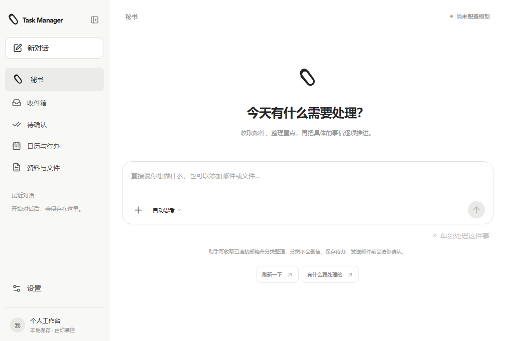

# Windows 版本验收记录

日期：2026-11-22。版本：0.2.0，Windows x64 预览版。

验证提交：[bdead3be](https://github.com/whatislove-baby/task-manager-secretary/commit/bdead3be25ff7a8dfa6404f18bff061f83ea86cb)。[完整 Windows 构建记录](https://github.com/whatislove-baby/task-manager-secretary/actions/runs/45004279975)。后续说明文档提交不改变这份成品的代码。

## 环境与结果

在 GitHub 的 Windows Server 2025 x64 环境执行。成品使用独立 Python 3.12.13 与 LibreOffice 26.8.3；开发检查使用 Python 3.12.10 和 Node.js 24。验收启动实际 EXE，并直接运行包内的 Python、文档渲染器和 Windows 任务计划程序。

| 检查 | 最终结果 | 证据 |
| --- | --- | --- |
| Python 后端完整回归 | 684 项：670 通过，14 跳过，0 失败；833.347 秒 | `regression.log` |
| 前端与桌面回归、类型检查、构建 | 406 / 406 通过；类型检查与构建通过 | `regression.log` |
| 成品 Python 桥接、SQLite、邮箱接口与后台进程 | 通过 | CI 中的 `PYTHON_PACKAGE_PASS` |
| Windows 计划任务注册、重复启用、实际执行和清理 | 通过 | `scheduler.log` |
| 文件、草稿、日历与持久化工作流 | 24 / 24 通过 | `workflow/workflow.json` |
| 实际 EXE、前后端接口、日历页面与退出重开 | 12 / 12 通过 | `app/app.json`、页面截图 |

详细结果随发布提供在 `Windows-Verification.zip` 中；表中路径均相对该证据包。程序 ZIP 的 SHA-256 在同一发布页的 `SHA256SUMS.txt` 中。

14 项跳过包括 11 项可选 Docker 容器测试、3 项仅适用于 Mac 的凭据格式检查。前端与桌面测试分两组运行（395 + 11）；最终发布门禁检查六组验收均通过后才允许上传程序。

## 实际执行的完整流程

1. 在空白、含中文和空格的独立数据目录启动 Windows EXE。确认固定秘书主页可见、没有内置账号或密钥；创建待办，进入日历，再退出重开，核对秘书与任务 ID 保留。
2. 导入合成课程邮件和现有 Word 模板。经官方 Deep Agents 工具链提出待办，由用户批准后保存；再次批准改期，确认更新的是同一个任务。
3. 修改模板指定段落和表格，保留原件、图片与页眉页脚；用包内 LibreOffice 转成 PDF，检查内容及渲染页面；将本轮 Word 和 PDF 同时加入回复草稿，重开服务后再次核对附件。
4. 输入损坏的 PDF，确认拒绝解析，保留此前成果。邮件草稿没有创建发送回执，没有进行外部 SMTP 投递。
5. 使用真实 Windows DPAPI 保存合成凭据，在新进程中解密读取。使用当前用户的普通权限计划任务执行一次包内 `pythonw.exe`，核对空白、停用的邮箱资料没有发起收信任务，最后删除本次创建的任务。

图片来自该成品在 Windows 验收时的真实界面。已查看秘书主页、日历和 Word/PDF 页面截图，核对中文显示、图表、表格、页眉页脚与分页。自动脚本输出的原始 JSON 保持不变，截图检查结果记录在本报告中。

## 移植中发现并修复的问题

| 问题 | 修改 |
| --- | --- |
| 计划任务把 SID 转成账户名后被误判为其他用户 | 用系统身份接口统一转回 SID，再严格检查所有者、登录触发器和任务标记 |
| electron-builder 合并数组后重复复制 Python/backend，偶发 DLL 占用 | 使用独立构建配置；检查资源目标唯一、失败退出码及本次新生成 ZIP |
| Windows 写入 Skill 源码时重复转换 CRLF | 按 UTF-8 原始字节写入，保留源文件内容 |
| 归档查询未及时关闭 SQLite 连接 | 显式关闭连接，避免 Windows 文件占用 |
| ASAR 分隔符、临时目录短路径影响验收 | 使用系统路径分隔符和真实目录规范化比较 |
| 测试阻断了 Windows asyncio 内部回环连接，部分临时库清理过早 | 仅允许数字回环地址，保留外部网络阻断；关闭资源后清理目录 |
| 文档渲染器依赖在不同 Windows 包中不一致 | 检查实际 PE 依赖，随包提供适用的官方 x64 运行组件及许可 |

## 范围与团队交接

这些检查使用合成邮件、受控模型回复和空白资料目录，验证实际框架、工具调用与文件/状态结果。没有使用个人 OpenRouter Key 或真实收件箱，因此不将它解释为在线模型质量、各邮箱服务商授权或真实邮件投递已经通过。

Windows Docker Desktop 的实际容器 Skill 执行仍未进行端到端验收；相关可选测试跳过。普通 PDF、Word、CSV 工具不依赖 Docker。Windows ARM 设备以及组员自己的 Windows 10/11 机器尚未逐台交接测试。

组员按 [Windows 使用与交接](WINDOWS.md) 中的课程通知练习，填写 [团队交接表](TEAM-START.md#5-交接记录模板)，记录实际账号连接、文件与附件检查结果。自动验收记录不能代替学生本人完成的交接。
