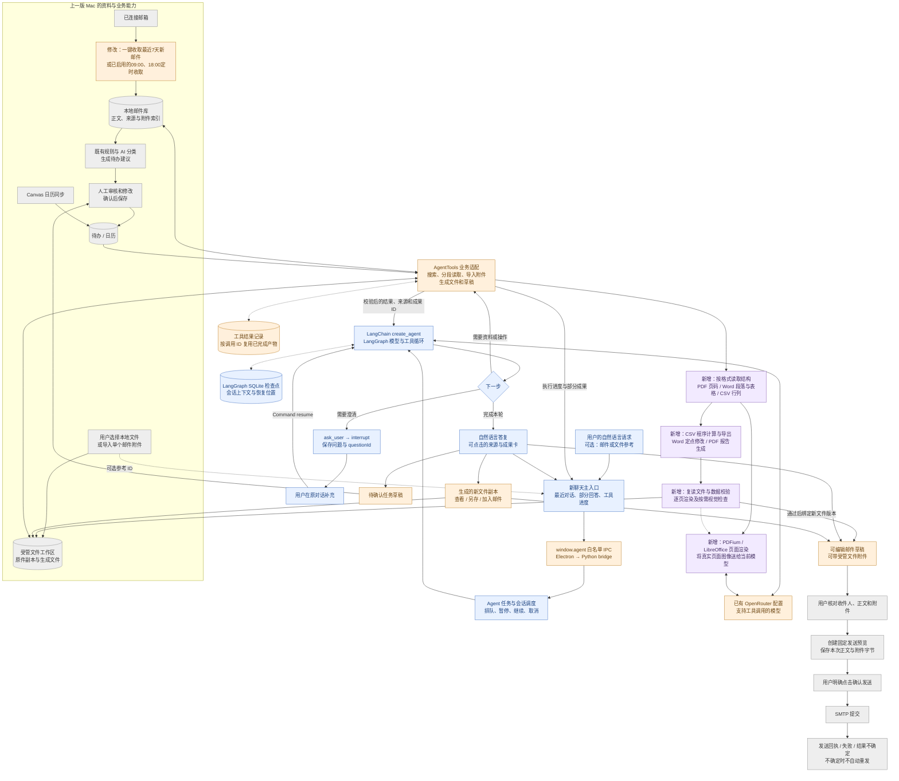

# 对话 Agent 工作流（2026-11-21）

此图保留迁移前的实现。当前架构与本轮新增部分见 [Deep Agents 工作流](workflow-deepagents.md)。

用户直接描述要处理的事情，助手自行查找已导入的邮件、文件和待办；有实质歧义时先提问，再继续同一任务。选邮件、上传资料是可选的补充，不要求先选空间或切换“文件处理”模式。

本图保留各轮改动：灰色为此前 Mac 业务能力，蓝色为对话 Agent，橙色为业务接入适配，**紫色为本轮 PDF/CSV/Word 读写与检查**。灰色包含此前我们添加的定时整理、附件及发送保护，并不表示全部来自同学最初的上游仓库。上一轮流程留在[附件与文件处理版](workflow.md)。

图中“成果卡 → 文件/草稿”表示用户看到和打开成果的路径。文件与草稿实际由工具执行时创建，工具返回真实 ID 后才展示；不会仅凭模型说“已完成”就伪造一个文件或保存成功提示。

## 一次任务怎样完成

1. **先有可查询的资料。** 收件箱“收取新邮件”一次收取全部已连接邮箱最近7天的收件箱，不继承旧主题预设或要求逐封勾选；也可沿用已启用的定时流程。本地资料经原生文件选择器复制进受管工作区。新 Agent 搜索的是这些已导入资料，不会因为问“最新邮件”就绕过收取流程直接搜索整台电脑或所有远端邮件。
2. **从自然语言开始。** 例如“帮我看 Project 2 还缺哪些材料，整理清单并起草一封给老师的邮件”。模型可以连续查询邮件、读取附件、查看任务，再决定是否继续检索。用户无需先选课程空间。
3. **必要时停下来问。** `ask_user` 通过 LangGraph `interrupt` 保存中断；用户答案与该问题的 ID 一起恢复原任务。澄清只是补充信息，不能代替邮件发送确认。
4. **交付真实结果。** 回答以 Markdown 展示；来源打开已有邮件、文件或任务。生成文档保存为新副本，待办和邮件作为草稿进入待确认。每种结果都对应后端记录。
5. **由用户确认最终动作。** 待办审核通过后才进入任务库。邮件需编辑、生成固定预览，再明确确认 SMTP 发送。模型没有发送接口。

定时整理继续使用上一版独立后台流程，它不会替用户启动任意长任务，也不会自动读取所有附件。Mac 应用及后台进程必须在运行；本机定时任务不等于云端 24 小时服务。

## 状态、上下文和恢复

| 机制 | 当前含义 |
| --- | --- |
| 会话 | 最近对话和用户/助手消息持久保存，同一会话继续使用框架中的历史上下文。 |
| 工具循环 | `create_agent` 根据模型的工具调用执行有界业务工具，再把结果交回模型；本轮不再限制为一次固定 JSON 提取。 |
| 检查点 | LangGraph SQLite 保存执行状态；任务可等待澄清、暂停或在失败后继续。恢复仍受当前配置和状态校验约束。 |
| 产物复用 | 工具调用 ID 与结果记录用于恢复时复用已经创建的文件和草稿，避免同一次调用重复生成。暂停、取消不回滚已完成的操作。 |
| 长对话 | 使用框架摘要中间件压缩较长上下文，并保留近期消息；不承诺无限上下文或永久准确记忆。 |
| 进度 | 后端保存真实部分回答与工具事件，前端轮询更新。工具开始和结束按调用 ID 合并；失败、暂停不会显示一直执行中的动画。 |

## 现在的边界

- 当前工具是应用内白名单：查阅邮件、受管文件、待办和账号公开信息，按需导入受支持附件，生成文档及草稿。没有通用 MCP 客户端、联网搜索、shell 执行或任意本地目录读写。
- 文件支持 PDF、DOCX、CSV、TXT、Markdown；扫描 PDF 可按页交给视觉模型，CSV 用程序计算，Word 支持保留其他内容的定点修改。PDF 写入仍以新报告为主，不承诺任意原版面改字。详见[文件工作流与限制](document-workflows.md)。
- 新对话可按意图查资料，但没有独立的发件人画像库、自我改写技能或自动积累可执行 skill。会话历史、检查点和工具结果记录不等于这些功能。
- 任务草稿不是正式日历事项；邮件草稿不是待发指令。发送结果不确定时需人工核实，不通过恢复 Agent 自动重发。
- 模型只收到完成当前请求所需的业务内容、工具结果及所查看的文档页面图像；密钥不进入对话。导入与 API 使用范围仍由既有设置和用户请求决定。

## 代码位置与验证入口

| 层 | 文件 |
| --- | --- |
| 对话主界面与结果呈现 | `src/renderer/AgentApp.tsx`、`AgentPages.tsx`、`AgentMessageBody.tsx` |
| 接口契约 | `src/shared/agent.ts`、`src/main/preload.ts` |
| Agent 调度、图和模型适配 | `backend/task_backend/agent_runtime.py`、`agent_worker.py`、`agent_openrouter.py` |
| 工具与业务边界 | `backend/task_backend/agent_tools.py`，复用既有邮件、文件、任务和写信服务 |
| 人工邮件确认 | `src/renderer/MailComposePanel.tsx`、`backend/task_backend/mail_compose.py` |

前端验收与合成截图见对话界面交接记录（本地历史材料未随仓库发布）。框架依赖与正式打包验收方法见[运行时与打包说明](agent-runtime-build.md)。流程图表达已实现的调用关系，不替代真实模型质量、实际邮箱连通性或分发包验收报告。
