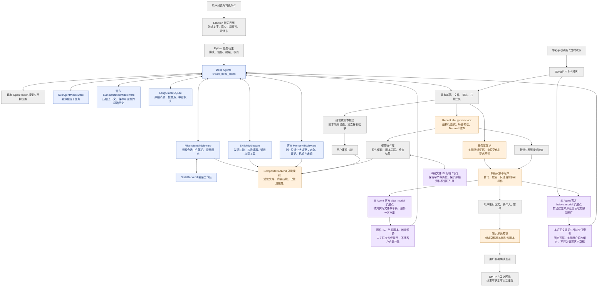

# Deep Agents 迁移后的工作流

2026-11-21。灰色是迁移前已有的应用能力，蓝色是直接复用的 Deep Agents 官方机制，橙色是初次迁移的业务适配，紫色是本次补齐的归档、上下文和交付检查。旧图保留在 [workflow-agent.md](workflow-agent.md)，首次迁移验收（本地历史材料未随仓库发布）与本次修复复测（本地历史材料未随仓库发布）分别保留。

## 复用与自有代码的界线

| 部分 | 使用方式 |
| --- | --- |
| 模型与工具循环 | 官方 `deepagents==0.7.41` 的 `create_deep_agent`，由其组合 LangChain/LangGraph；没有另写规划执行循环。 |
| 文件系统 | 官方 `StateBackend` 保存会话笔记，`CompositeBackend` 路由到应用只读目录；应用只实现安全的资料适配。 |
| 技能 | 官方 `SkillsMiddleware` 按需公开文档处理和执行工具；`propose_skill` / `propose_learning` 使用官方基础工具注册、始终可见，避免长对话摘要后无法修订刚教过的方法。批准状态、内容哈希与客户范围仍由既有技能库核验。 |
| 业务规范 | 官方 `MemoryMiddleware` 每轮注入只读规则，关键证据边界不再依赖某个 SKILL 恰好被读取。邮件、附件和已给出的用户答复都可提供证据；未知供应能力不等于客户要求未知。 |
| 长上下文 | 官方摘要中间件，应用预算为约 32,000 tokens 触发、保留约 6,000 tokens；这不是模型最大上下文声明。原始历史保存在检查点和可读历史文件。 |
| 子任务 | 官方子任务机制；继承应用工具、约束与只读资料后端。没有另建多 Agent 调度器。 |
| 邮件来源与草稿状态 | 应用业务规则，不属于框架通用能力。正文变化、旧稿拒发等必须由代码验证，不能仅靠提示词。 |
| 新邮件与当前交付上下文 | 官方 `before_model` 扩展点，每个真实用户输入（含澄清回复）最多建立一次快照；复用实际 `read_mail` 与证据记录。按账号、邮箱身份、精确发件地址筛选，明确选择优先，否则使用本会话当前草稿来源；只有搜索结果不会激活范围。限制 3 个来源、每来源 25 个候选、4 封正文、12,000 字和 6 次分页，截断明确标注，不宣称已查全部邮件。索引只列本对话实际 active 草稿和附件，不能替模型判断订单关系。 |
| 文件归档与交付复查 | 复用已有 SQLite 生命周期与锁；官方中间件扩展点触发一次补正。精确 ID 和哈希可确定性核验，模型对文件与客户的语义对应仍需判断。子代理不接管父任务的交付检查。 |
| 文档 | 成熟的 ReportLab/python-docx 负责渲染；结构化规格保留行 ID、列宽与样式，修订只更改指定字段。不是任意 PDF 原位编辑器。 |

## 边界

- 会话工作区是虚拟文件系统，不是整个电脑；生成可交付附件仍需受管文档工具。
- 脚本只通过既有隔离技能运行器执行。没有任意宿主 shell，也没有因引入 Deep Agents 就自动开放联网或 MCP。
- 技能提议、测试通过、用户批准是不同状态；会话笔记不能替代批准。
- 新邮件保护覆盖本地已导入邮件的相关来源；不会自动验证尚未同步到本地的远端新信。
- 框架能管理上下文和执行过程，不能保证模型永远理解正确。以相同场景的实际产物、草稿状态与失败记录判断效果。

官方来源：[Deep Agents 仓库](https://github.com/langchain-ai/deepagents)、[框架文档](https://docs.langchain.com/oss/python/deepagents/overview)。应用接入位于 `agent_runtime.py`、`deepagents_backend.py`，其余邮件、文件和技能服务继续复用。
