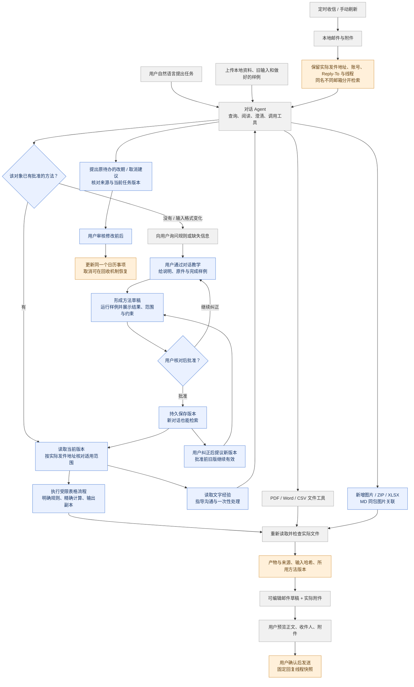

# 邮件助手：从用户指导到可复用方法

> 本文保留上一阶段“文字经验 + 受限表格规则”的实现。当前已扩展为 AI 自选 Markdown / Python / 混合技能，见 [最新彩色工作流](workflow-skills.md)。下文的任意代码限制指旧 learning 接口。

灰色是本轮以前已有的流程，蓝色是本轮新增，橙色是本轮改动或补强。原始流程见 [Agent 工作流](workflow-agent.md)，本轮证据见 场景验收报告（本地历史材料未随仓库发布）。

当前的“学习”是应用保存并检索用户确认的方法，不是重新训练底层模型。支持文字经验，以及列映射、料号拼接、筛选、排序、分组与精确计算等受限 CSV/XLSX 流程。AI 不自行批准规则，也不能生成并执行任意 Python 或 shell。

自动收信整理仍用于分类和提出待确认事项；它不会在无人审核时自动运行客户方法、改写文件或发信。引用、生成文件和方法版本可以回看；旧版本产物不被新规则覆盖。遇到缺价、陌生表头、客户不匹配或方法已停用，执行应停止并说明。
