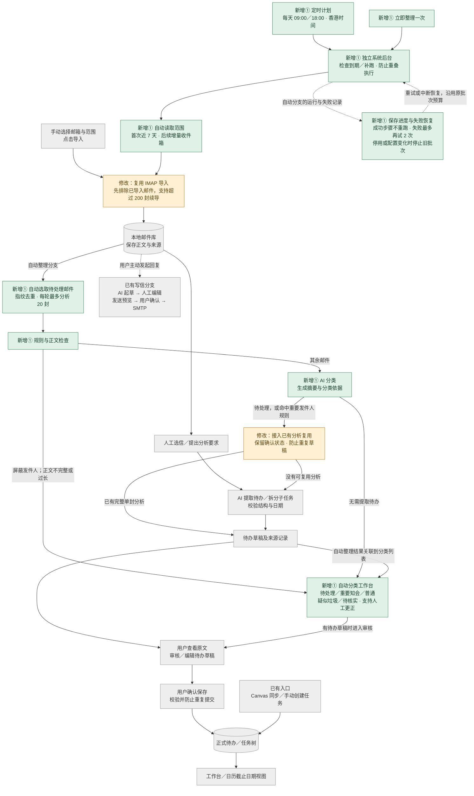

# 工作流更新 · 功能 ① 定时收取与自动整理

更新日期：2026-11-20。比较基准为**本轮定时整理开发前的 Mac 版**，不是原始上游仓库；此前已增加的邮件写作等能力也标为灰色。

**灰色＝本轮前已有／继续复用；绿色＝本轮新增；橙色＝本轮修改或增强。** 节点同时标注“新增／修改”，不只依赖颜色。

## 阅读说明

- **自动整理与手动导入是两个入口**。自动整理使用独立后台和自己的计划／进度记录；原手动导入、分析队列及其暂停恢复入口继续保留。
- 默认 20 封是**每批 AI 分析预算**；200 封是 IMAP 单批导入候选上限，两者不同。超过分析预算的候选留给下一计划或手动新批次。
- 屏蔽发件人直接归“疑似垃圾”；正文不完整或过长直接归“待核实”，均不调用分类模型。其余邮件由 AI 分类。重要发件人规则优先于模型给出的普通／垃圾分类。
- **仅分类为待处理，或命中用户设置的重要发件人规则，才进入自动提取路径**。模型单独判为“重要知会”不等于一定生成待办。提取为空时，重要发件人保留重要知会，其余需要行动但无草稿的邮件留待核实。
- 新增分析复用的是原有提取器和审核界面；先查已有完整单封分析，保留已确认状态。提取结果及步骤检查点也会持久保存，重试不会故意重复成功步骤。
- 原文、分类和草稿会保存在本机。**自动整理不会删信、发信或自动确认正式待办**；写信是用户主动操作的独立分支。
- 启用系统后台后，失败约 5／30 分钟后有限重试，总最多 3 次；没有后台时需人工触发恢复。关机或休眠时不能收信，恢复后检查补跑。已在途网络请求无法撤回，后续步骤会检查停用与配置变化。
- 日历节点表示已有的截止日期视图，**没有新增自动寻找空闲时间、长期项目记忆或依赖驱动执行**。

## 验证状态

- 自动化与成品验证（本地历史材料未随仓库发布）：131 项 Python、319 项前端／桌面测试通过，1 项 Windows 专属跳过。
- 真实 QQ＋OpenRouter 首轮（本地历史材料未随仓库发布）：用户授权后立即运行一轮；新导入 12 封，共整理 16 封，失败 0；复用 2 份已确认分析，新增 1 项待确认草稿，正式待办数未增加。
- 已跑通首轮立即整理；未来 09:00／18:00 的自然定时触发、整夜运行及真实休眠唤醒仍待观察。此图表示当前实现，不表示没有剩余问题。

## 代码定位

| 图中环节 | 主要代码 |
|---|---|
| 系统后台／应用退出后独立运行 | `src/main/mail-automation-host.ts`、`backend/task_backend/automation_worker.py` |
| 计划、补跑、预算、分类、复用、重试 | `backend/task_backend/mail_automation.py` |
| 续导修复与共享导入 | `backend/task_backend/mail_readers.py`、`mail_store.py`、`mail_workspace.py`、`operations.py` |
| 自动整理设置与分类工作台 | `src/renderer/MailAutomationPanel.tsx` |
| 原提取与人工确认 | `backend/task_backend/service.py`、`mail_workspace.py`；原草稿审核界面 |
