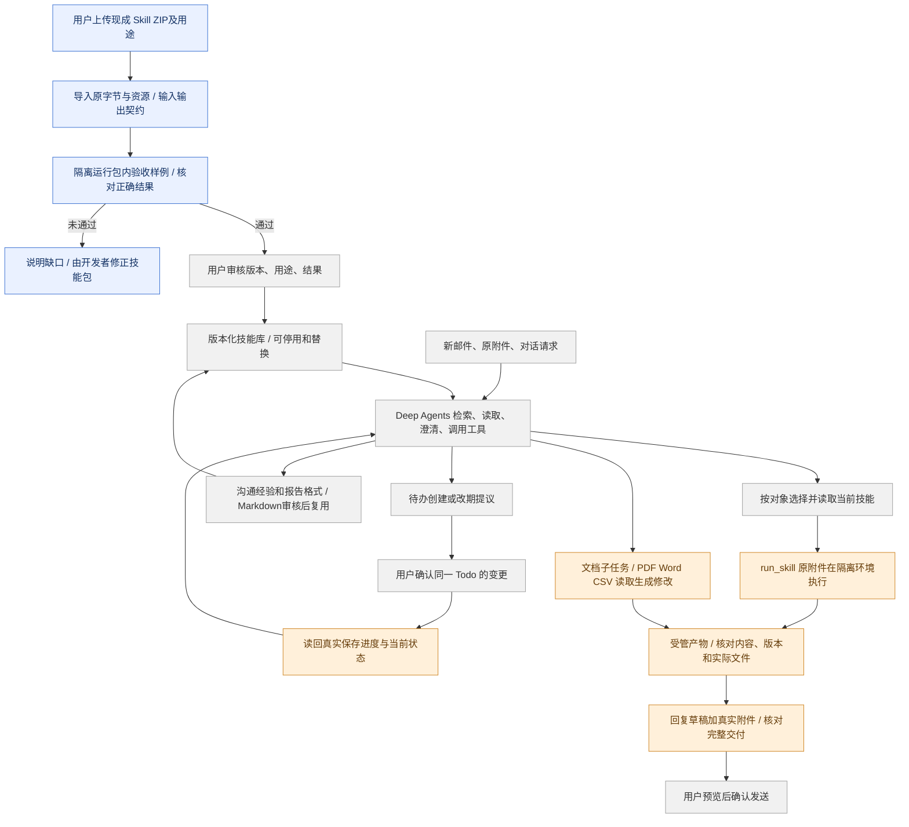

# 已开发技能导入与邮件工作流

本轮范围调整：复用已开发、可核对的业务程序；不再把“AI 根据自然语言重新开发该程序”作为交付要求。灰色是已有功能，蓝色为新增导入，橙色为本轮修复。

技能说明使用 Deep Agents 的渐进加载；执行复用现有 Docker 运行器。首次包验证和用户审核与后续业务调用分开，正常新输入不重新要求样例。技能不会自行发信或改变日历状态。

普通文档处理不需要用户开发业务程序。未找到适用的客户技能时说明缺口，不能为追求完成而生成未经验证的替代转换脚本。

[导入格式、使用方法和第一个实例](imported-skills.md)。此前自动编写脚本的验证记录保留在历史 handover 目录，不代表本轮目标或当前通过结果。
