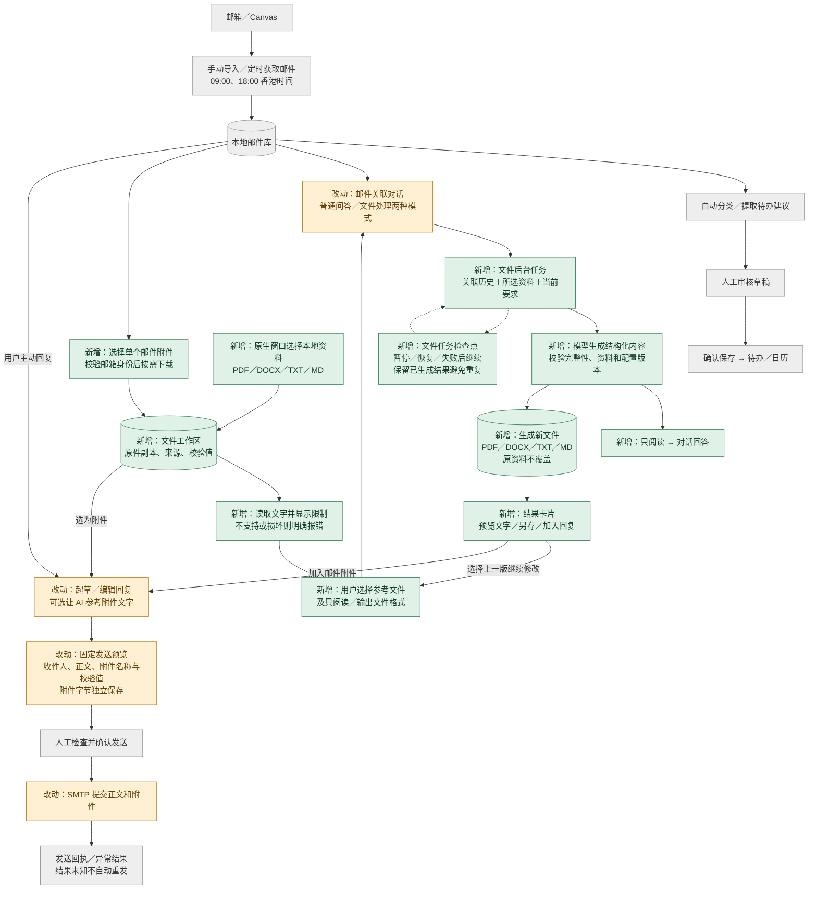

# 邮件助手工作流 附件与文件处理版

灰色表示本轮开发前已有的能力（包括上一次新增的定时整理）；绿色表示本轮新增；橙色表示本轮改动。上次版本保留在 [定时整理版流程图](workflow-scheduled-mail.md)。

文件任务由固定工作流调度，不执行模型生成的脚本，也没有新增通用 MCP、跨会话技能或自动发信。每次明确选择资料；定时整理不会自动把所有附件交给模型。

PDF／Word 读取正文文字后生成新文档，不保证保留原排版；扫描件需先 OCR。对话中的历史文件不会被自动全部重新读取，修改时应选中对应文件。只有点击文件处理提交或勾选附件参考后点击 AI 起草，相关文字才发送到设置中的模型。

代码入口：`mail_files.py`（读取和产物）、`document_assistant.py`（文件任务）、`operations.py`（队列和会话）、`mail_compose.py`（固定附件快照）、`MailFiles.tsx`／`AIHistoryPanel.tsx`／`MailComposePanel.tsx`（操作界面）。完整验证记录见 附件与文件处理报告（本地历史材料未随仓库发布）。
